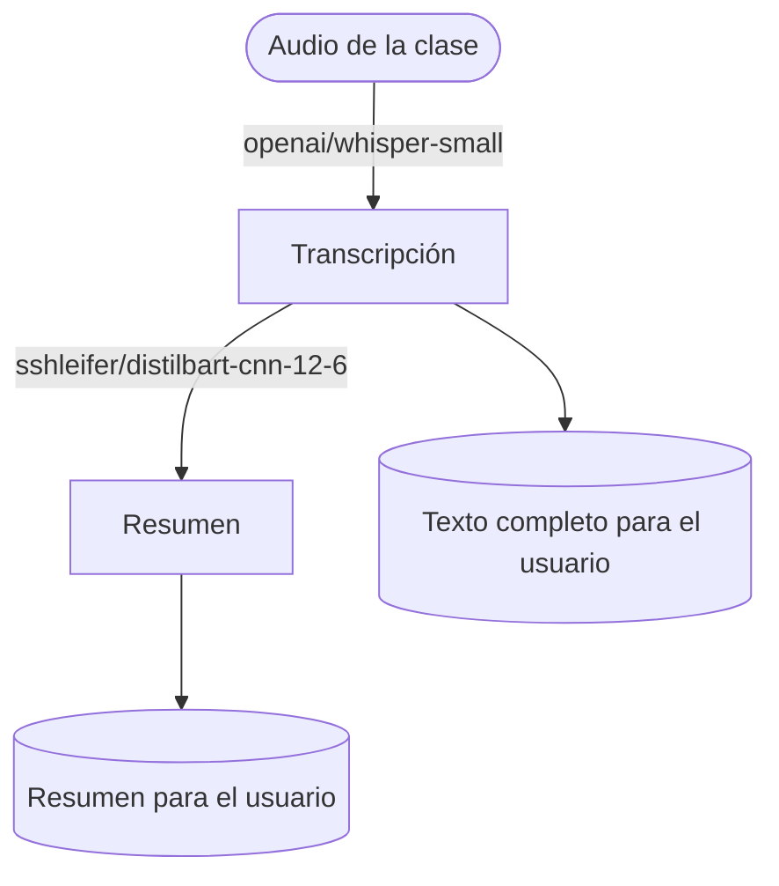

# Model Card del modelo en Hugging Face: Whisper (speech-to-text)

**La correcta transcripción y el resumen de audio a texto**

Proyecto integrador · Herramientas de IA
Grupo: B1 · Equipo: 4

## 👥 Integrantes

- Fernanda Narahi Rayas Flores
- Paulina Alejandra Ramírez Olmos
- Luciano Nery Reynoso Orozco
- Jorge Andrés Ruiz López

## 1. Caso de uso

Estudiantes (de cualquier nivel) que graban clases largas o de mucha teoría y necesitan repasarlas sin volver a escuchar todo el audio. El sistema transcribe la grabación con Whisper y genera un resumen breve con DistilBART.

- **Entrada:** un archivo de audio (MP3, M4A o WAV) con la grabación de una clase, reunión o discurso.
- **Salida:** la transcripción completa en texto y un resumen corto de su contenido.

### 🔀 Cómo funciona

## 2. Modelo abierto elegido

| Dato | Respuesta |
|------|-----------|
| Identificador | [openai/whisper-small](https://huggingface.co/openai/whisper-small) |
| Tarea (pipeline tag) | `automatic-speech-recognition` |
| Número de parámetros | `244 M (244,000,000)` |
| Licencia | `Apache 2.0` |
| Limitación o sesgo declarado | Es un modelo multilingüe entrenado en 99 idiomas, pero el rendimiento varía según el idioma: está más entrenado en inglés que en otros idiomas |

## 3. Viabilidad de hardware

$$
\text{Memoria mínima} = 244{,}000{,}000 \times 2\ \text{bytes} \approx 0.488\ \text{GB}
$$

- **VRAM disponible en Colab:** ~15 GB (GPU Tesla T4)
- **Dónde se ejecuta:** Colab con GPU
- **Por qué:** los pesos de Whisper-small en FP16 ocupan solo ~0.49 GB, muy por debajo de los ~15 GB de la T4. Esta cifra es solo de los pesos; en ejecución se necesita memoria extra para activaciones y buffers.

## 4. Riesgo ético

- **Riesgo:** Las grabaciones pueden contener información personal o conversaciones privadas de estudiantes y profesores.
- **Mitigación:** Obtener consentimiento antes de procesar las grabaciones, no almacenar los audios después de la transcripción y eliminar datos personales innecesarios del texto resultante.

## 5. Evidencia